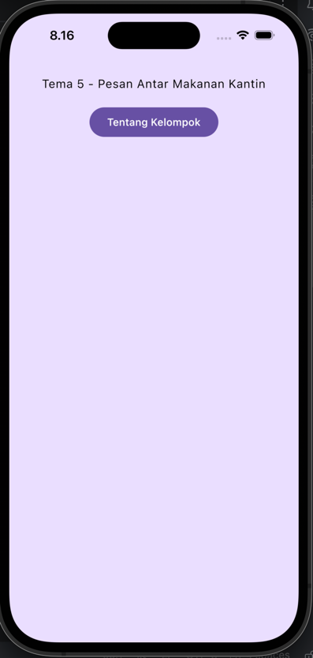
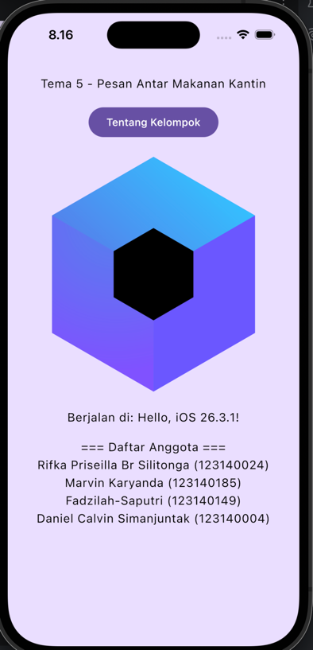
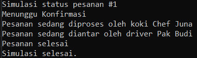
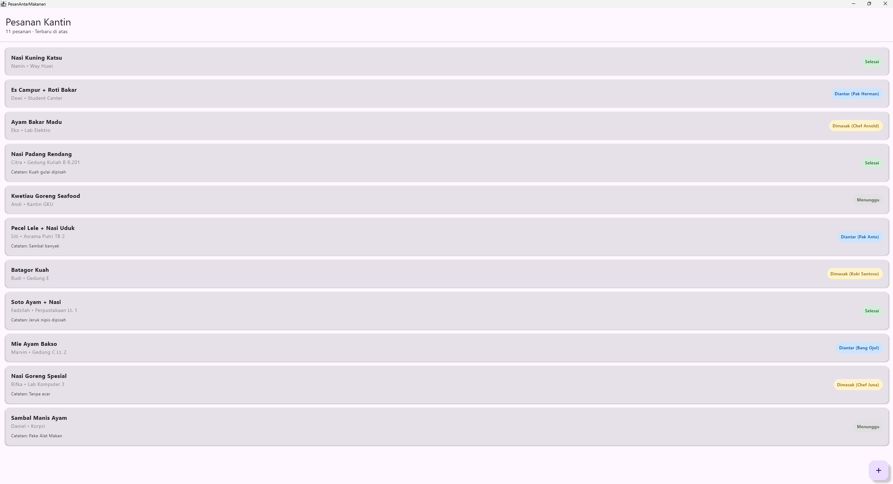
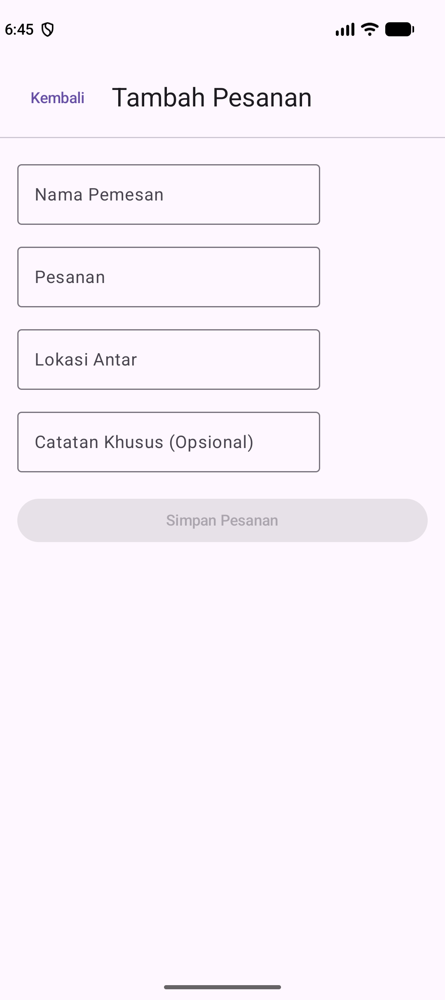
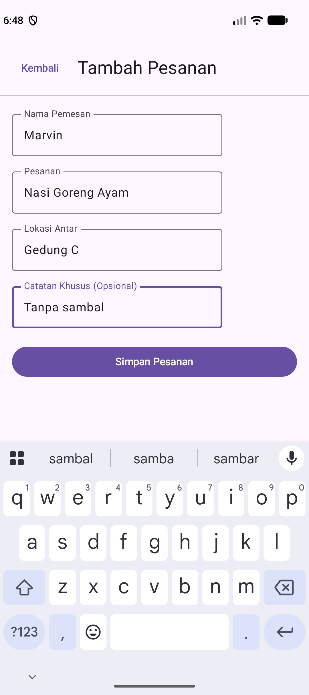
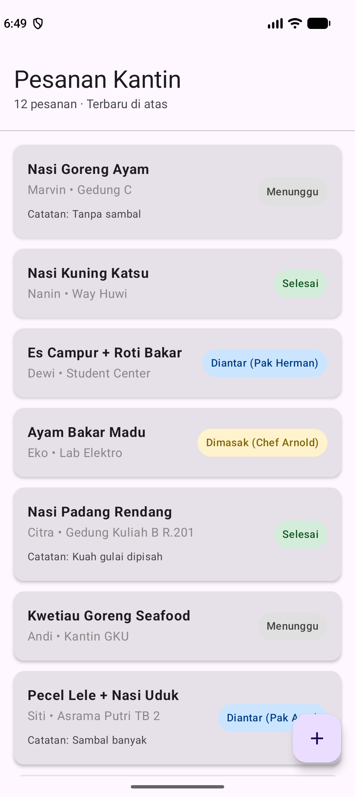

# Tema 5 - Pesan Antar Makanan Kantin

Repository ini berisi proyek aplikasi Kotlin Multiplatform (KMP) untuk mata kuliah Pengembangan Aplikasi Mobile. Proyek ini dibangun dari *template* Compose Multiplatform.

## Anggota Kelompok

* **Ketua:** Rifka Priseilla Br Silitonga (123140024)
* **Anggota:**
  * Daniel Calvin Simanjuntak (123140004)
  * Fadzilah Saputri (123140149)
  * Marvin Karyanda (123140185)

## Modul 1 - Pengenalan Project

Tampilan awal aplikasi berisi judul tema dan tombol Tentang Kelompok untuk
menampilkan platform serta daftar anggota kelompok.

### Tangkapan Layar Aplikasi

<table align="center" border="1" rules="all" cellspacing="0" cellpadding="10" style="display: table; margin-left: auto; margin-right: auto; border-collapse: collapse; border: 1px solid #888;">
  <thead>
    <tr>
      <th width="270" style="border: 1px solid #888; padding: 10px; text-align: center;">Tampilan Awal</th>
      <th width="270" style="border: 1px solid #888; padding: 10px; text-align: center;">Informasi Kelompok</th>
    </tr>
  </thead>
  <tbody>
    <tr>
      <td align="center" valign="top" style="border: 1px solid #888; padding: 10px;">
        <a href="img.png"></a>
      </td>
      <td align="center" valign="top" style="border: 1px solid #888; padding: 10px;">
        <a href="img_1.png"></a>
      </td>
    </tr>
  </tbody>
</table>

## Modul 2 - Simulasi Status Pesanan

Program menggunakan `SumberPesananPalsu` untuk menghasilkan perubahan
status melalui `Flow`. Setiap status diterima dengan `collect`, kemudian
ditampilkan di konsol menggunakan fungsi `label()`.

### Hasil Pengujian

Status muncul berurutan sesuai jeda simulasi:

```text
Simulasi status pesanan #1
Menunggu Konfirmasi
Pesanan sedang diproses oleh koki Chef Juna
Pesanan sedang diantar oleh driver Pak Budi
Pesanan selesai
Simulasi selesai.
```

Program selesai tanpa error dan Gradle menampilkan `BUILD SUCCESSFUL`.

### Screenshot Hasil Konsol

<table align="center" border="1" rules="all" cellspacing="0" cellpadding="10" style="display: table; margin-left: auto; margin-right: auto; border-collapse: collapse; border: 1px solid #888;">
  <thead>
    <tr>
      <th style="border: 1px solid #888; padding: 10px; text-align: center;">Hasil Simulasi Status Pesanan</th>
    </tr>
  </thead>
  <tbody>
    <tr>
      <td align="center" style="border: 1px solid #888; padding: 10px;">
        <a href="docs/hasil-simulasi.png"></a>
      </td>
    </tr>
  </tbody>
</table>

## Modul 3 - Daftar Pesanan dan Tombol Tambah

Daftar menampilkan 11 pesanan dummy menggunakan `LazyColumn` dan
`KartuPesanan`, diurutkan dari ID terbesar dengan `sortedByDescending`.
Setiap kartu berisi nama pemesan, rincian pesanan, lokasi antar, catatan
jika ada, dan status pesanan.

Tombol tambah (FAB) berada di kanan bawah dan tetap terlihat saat daftar
digulir. Tombol ini belum menambah data atau membuka formulir.

### Tangkapan Layar Aplikasi

<table align="center" border="1" rules="all" cellspacing="0" cellpadding="10" style="display: table; margin-left: auto; margin-right: auto; border-collapse: collapse; border: 1px solid #888;">
  <thead>
    <tr>
      <th style="border: 1px solid #888; padding: 10px; text-align: center;">Daftar Pesanan dan Tombol Tambah</th>
    </tr>
  </thead>
  <tbody>
    <tr>
      <td align="center" style="border: 1px solid #888; padding: 10px;">
        <a href="docs/daftar-pesanan-fab.png"></a>
      </td>
    </tr>
  </tbody>
</table>

## Modul 4 - Form Pesanan dan Daftar Reaktif

Tombol tambah (FAB) sekarang membuka form pesanan. Nama pemesan, pesanan,
dan lokasi antar wajib diisi, sedangkan catatan khusus boleh kosong.
Tombol Simpan Pesanan aktif setelah semua kolom wajib terisi.

Setelah disimpan, aplikasi kembali ke daftar dan pesanan baru langsung
muncul di urutan teratas. Daftar mengikuti perubahan `StateFlow`, jadi
tidak perlu membuka ulang aplikasi. Tombol Kembali bisa digunakan untuk
kembali ke daftar tanpa menyimpan. Data masih disimpan di memori dan akan
kembali ke data dummy saat proses aplikasi dimulai ulang.

### Tangkapan Layar Aplikasi

<table align="center" border="1" rules="all" cellspacing="0" cellpadding="10" style="display: table; margin-left: auto; margin-right: auto; border-collapse: collapse; border: 1px solid #888;">
  <thead>
    <tr>
      <th style="border: 1px solid #888; padding: 10px; text-align: center;">Form Kosong</th>
      <th style="border: 1px solid #888; padding: 10px; text-align: center;">Form Terisi</th>
      <th style="border: 1px solid #888; padding: 10px; text-align: center;">Pesanan Baru di Daftar</th>
    </tr>
  </thead>
  <tbody>
    <tr>
      <td align="center" valign="top" style="border: 1px solid #888; padding: 10px;">
        <a href="docs/form-pesanan-kosong.png"></a>
      </td>
      <td align="center" valign="top" style="border: 1px solid #888; padding: 10px;">
        <a href="docs/form-pesanan-terisi.png"></a>
      </td>
      <td align="center" valign="top" style="border: 1px solid #888; padding: 10px;">
        <a href="docs/pesanan-baru.png"></a>
      </td>
    </tr>
  </tbody>
</table>

## Panduan Menjalankan Project

### Menjalankan Aplikasi di Android Studio

1. Buka Android Studio, pilih **Open**, lalu pilih folder utama project.
2. Tunggu proses Gradle Sync selesai.
3. Pilih konfigurasi **androidApp**.
4. Pilih emulator Android atau HP yang sudah terhubung dengan USB debugging aktif.
5. Klik **Run** untuk membuka aplikasi.

### Menjalankan Simulasi Status Pesanan

Buka project di Android Studio, lalu buka tab **Terminal** dengan shell
**PowerShell**. Jalankan perintah berikut dari folder utama project:

```powershell
$env:JAVA_HOME = "C:\Program Files\Android\Android Studio\jbr"
$env:ANDROID_HOME = "$env:LOCALAPPDATA\Android\Sdk"
.\gradlew.bat :desktopApp:runSimulasi --console=plain
```

### Struktur Project

This is a Kotlin Multiplatform project targeting Android, iOS, Desktop (JVM).

* [/iosApp](./iosApp/iosApp) contains an iOS application. Even if you’re sharing your UI with Compose Multiplatform,
  you need this entry point for your iOS app. This is also where you should add SwiftUI code for your project.

* [/shared](./shared/src) is for code that will be shared across your Compose Multiplatform applications.
  It contains several subfolders:
  - [commonMain](./shared/src/commonMain/kotlin) is for code that’s common for all targets.
  - Other folders are for Kotlin code that will be compiled for only the platform indicated in the folder name.
    For example, if you want to use Apple’s CoreCrypto for the iOS part of your Kotlin app,
    the [iosMain](./shared/src/iosMain/kotlin) folder would be the right place for such calls.
    Similarly, if you want to edit the Desktop (JVM) specific part, the [jvmMain](./shared/src/jvmMain/kotlin)
    folder is the appropriate location.

### Running the apps

Use the run configurations provided by the run widget in your IDE's toolbar. You can also use these commands and options:

- Android app: `./gradlew :androidApp:assembleDebug`
- Desktop app:
  - Hot reload: `./gradlew :desktopApp:hotRun --auto`
  - Standard run: `./gradlew :desktopApp:run`
- iOS app: open the [/iosApp](./iosApp) directory in Xcode and run it from there.

### Running tests

Use the run button in your IDE's editor gutter, or run tests using Gradle tasks:

- Android tests: `./gradlew :shared:testAndroidHostTest`
- Desktop tests: `./gradlew :shared:jvmTest`
- iOS tests: `./gradlew :shared:iosSimulatorArm64Test`

---

Learn more about [Kotlin Multiplatform](https://www.jetbrains.com/help/kotlin-multiplatform-dev/get-started.html)…
